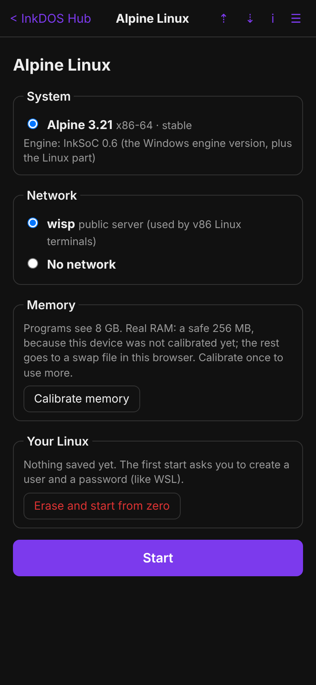

<p align="center"></p>

<h1 align="center">InkShell</h1>

<p align="center">A real Linux terminal in the browser: Alpine Linux with apk, internet and your files, on iPad, iPhone and PC.</p>

<p align="center"><b><a href="https://hub.inkdos.workers.dev/InkShell/">Open InkShell</a></b> · part of <a href="https://github.com/InkDOSHub/inkdoshub.github.io">InkDOS Hub</a> · MIT license</p>

<p align="center"></p>

## How it works

Alpine Linux 3.21 (x86-64) runs on [InkSoC](https://github.com/InkDOSHub/InkSoC), our own engine, which plays the part of the Linux kernel (system calls in WebAssembly, WSL 1 style) and runs Alpine's real programs with a JIT.

- First start creates your user and password (`sudo` works); type `help` for the guide.
- `apk` and internet through a public WebSocket tunnel (wisp); when it cannot be reached, through the InkDOS Hub's own relay (`/net/wisp/` on hub.inkdos.workers.dev, which cannot reach sites hosted on Cloudflare). Or no network.
- Linux starts as soon as the page opens. Inside InkOS (`?inkos=1`) it is the Terminal app and the page's header steps aside.
- Programs see 8 GB; real RAM follows this device's calibrated limit and the rest goes to swap in the browser storage.
- Your files stay in this browser between visits; ⇡ and ⇣ send and download files.

## Fast tools (WebAssembly catalog)

Many common programs are available as **native WebAssembly** builds. They run much faster than the x86 Alpine packages (often tens to hundreds of times on large data) because they skip the x86 JIT.

Install with the usual command (names must match the catalog):

```sh
apk add NAME
```

Examples that work today:

| Category | `apk add` names |
|---|---|
| Editors | `vim`, `nano`, `less` |
| Text tools | `grep`, `sed`, `onetrue-awk`, `findutils`, `coreutils`, `ripgrep` |
| Network | `curl` |
| Version control | `git` (local ops; clone/fetch/push still need `apk add --x86 git`) |
| Language | `python3` (brings `py3-pip` for pure-Python packages), `quickjs`, `lua5.4`, `bc` |
| Archives | `tar`, `gzip`, `xz`, `bzip2`, `zstd`, `zip`, `unzip`, `7zip` |
| Media / data | `ffmpeg`, `ffprobe`, `imagemagick`, `qpdf`, `sqlite`, `jq`, `file`, `hashtools` |

- `apk add NAME` → WebAssembly version (preferred).
- `apk add --x86 NAME` → classic Alpine x86 package (fallback).

If a WASM program is missing a feature, use the full path of the x86 binary (example: `/usr/bin/git` after `apk add --x86 git`).

## Limitations

- **No incoming connections from outside.** Servers you start (`nc -l`, a web server, `sshd`) can only be reached from inside this terminal (`127.0.0.1`), because a browser page can't accept connections from the network. So `sshd` is not set up: only `ssh localhost` would reach it.
- Timer signals (`alarm`, `setitimer`, `timer_create`) arrive at the program's next system call; a loop that never makes one doesn't get them.
- No desktop or 3D graphics: it is a terminal.
- Some WASM programs are still incomplete (e.g. `git` has no HTTPS clone yet; `nano` is ASCII-only).

## Files

| Path | What |
|---|---|
| `index.html`, `app.js`, `worker.js` | The page and the engine worker |
| `engine.wasm`, `engine-src/`, `linux.patch`, `engine-base.txt` | The InkSoC engine plus the Linux changes ([ENGINE.md](ENGINE.md)) |
| `alpine-rootfs.tar.gz`, `busybox`, `overlay/` | Alpine root file system and what InkShell adds on top (`overlay/build.sh` packs `overlay.tar`) |
| `tools/`, `tests/` | Engine sync and the Linux test (node) |
| `vendor/` | xterm.js |

## Part of InkDOS Hub

InkShell is one of the apps of [InkDOS Hub](https://hub.inkdos.workers.dev/), a free, open-source home screen of tools for iPad, iPhone and PC. It is published by GitHub Pages at `inkdoshub.github.io/InkShell/`, on the same site as the Hub. The public address `hub.inkdos.workers.dev/InkShell/` is the Hub's Cloudflare Worker, which serves these files with cross-origin isolation.

Other InkDOS Hub repositories: [Hub](https://github.com/InkDOSHub/inkdoshub.github.io) · [InkSoC](https://github.com/InkDOSHub/InkSoC) · [InkShell](https://github.com/InkDOSHub/InkShell) · [InkCam](https://github.com/InkDOSHub/InkCam) · [InkMind](https://github.com/InkDOSHub/InkMind) · [InkArcade](https://github.com/InkDOSHub/InkArcade) · [InkBench](https://github.com/InkDOSHub/InkBench)

## License

Code made here: [MIT](LICENSE). Third party: xterm.js (MIT), BusyBox (GPL-2.0) and Alpine Linux packages (each under its own license). WASM catalog programs carry their own licenses (see `THIRD_PARTY_LICENSES.md` and the catalog).
