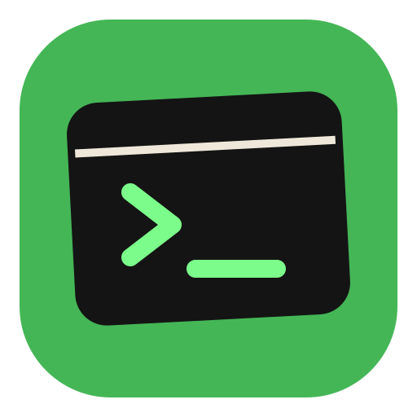
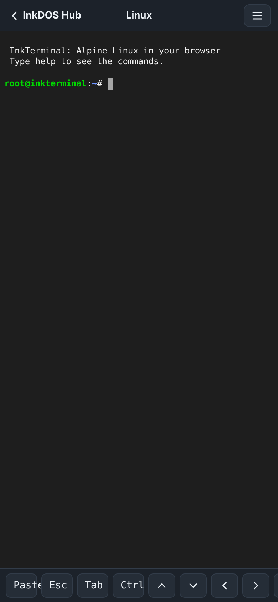
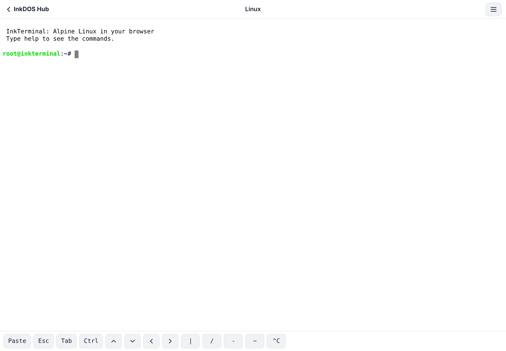

<h1 align="center">InkShell</h1>

A real Linux terminal in the browser: Alpine Linux with apk, internet and your files, on iPad, iPhone and PC.

<b><a href="https://hub.inkdos.workers.dev/InkShell/">Open InkShell</a></b> · part of <a href="https://github.com/InkDOSHub/inkdoshub.github.io">InkDOS Hub</a> · MIT license

 

## Two terminals

| | Linux terminal (root) | Alpine on InkSoC (`alpine/`) |
|---|---|---|
| Engine | [v86](https://github.com/copy/v86): a whole x86 PC emulated in WebAssembly, with a real Linux kernel | Our [InkSoC](https://github.com/InkDOSHub/InkSoC) engine playing the part of the Linux kernel (system calls in WebAssembly, WSL 1 style) running real x86-64 Alpine programs |
| Speed | Stable, slower | Experimental, much faster (JIT) |
| Extras | Session saving, the `~/files` folder shared with the device, keyboard bar for touch screens | 8 GB for programs with swap in the browser storage, user account like WSL |

Both have `apk` and internet through a WebSocket tunnel (wisp).

## Files

| Path | What |
|---|---|
| `index.html`, `app.js`, `swap-worker.js` | The v86 terminal |
| `images/`, `bios/`, `vendor/` | Linux image, SeaBIOS/VGABIOS, v86 and xterm.js |
| `tools/linux/` | Builds the kernel and the Alpine overlay (`build.sh`) |
| `alpine/` | Alpine on InkSoC; its engine is the InkSoC engine plus `alpine/linux.patch` ([alpine/README.md](alpine/README.md)) |

## Part of InkDOS Hub

InkShell is one of the apps of [InkDOS Hub](https://hub.inkdos.workers.dev/), a free, open-source home screen of tools for iPad, iPhone and PC. It is published by GitHub Pages at `inkdoshub.github.io/InkShell/`, on the same site as the Hub, so it shares the Hub's top bar, theme and language files (`/assets/`). The public address `hub.inkdos.workers.dev/InkShell/` is the Hub's Cloudflare Worker, which serves these files with cross-origin isolation (multithreaded WebAssembly).

Other InkDOS Hub repositories: [Hub](https://github.com/InkDOSHub/inkdoshub.github.io) · [InkSoC](https://github.com/InkDOSHub/InkSoC) · [InkShell](https://github.com/InkDOSHub/InkShell) · [InkCam](https://github.com/InkDOSHub/InkCam) · [InkMind](https://github.com/InkDOSHub/InkMind) · [InkArcade](https://github.com/InkDOSHub/InkArcade) · [InkBench](https://github.com/InkDOSHub/InkBench)

## License

Code made here: [MIT](LICENSE). Third party: v86 (BSD-2-Clause), SeaBIOS/VGABIOS (LGPL-3.0, `bios/COPYING.LESSER`), xterm.js (MIT), the Linux kernel (GPL-2.0) and Alpine Linux packages (each under its own license).
